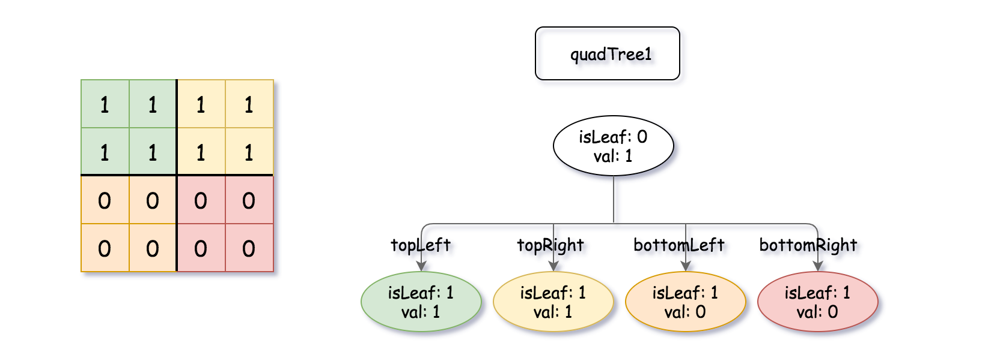
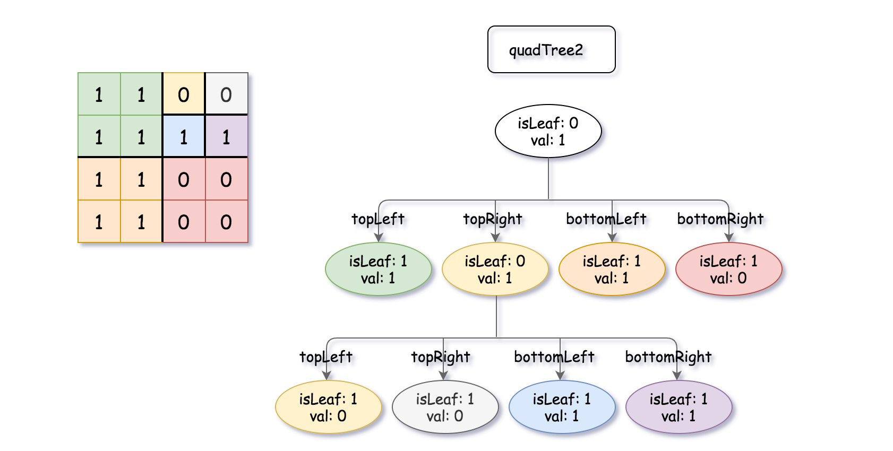

# 558. 四叉树交集

`quadTree1` 和 `quadTree2` 是两棵四叉树，各自表示一个 `n * n` 的二进制矩阵（元素只有 0 和 1）。返回一棵四叉树，表示这两个矩阵逐位**逻辑或**的结果。

四叉树的每个内部节点恰好有四个子节点，每个节点有两个属性：

- `val`：叶子节点所代表区域的值，1 为 True，0 为 False。`isLeaf` 为 False 时 `val` 可以取任意值。
- `isLeaf`：节点是叶子时为 True，有四个子节点时为 False。

```
class Node {
    public boolean val;
    public boolean isLeaf;
    public Node topLeft;
    public Node topRight;
    public Node bottomLeft;
    public Node bottomRight;
}
```

由矩阵构建四叉树的规则：如果当前区域的值全部相同，它就是一个叶子，`val` 为该值；否则它是内部节点，把区域等分为左上、右上、左下、右下四块，分别递归构建。因此结果中四个值相同的叶子必须合并成一个叶子。


**四叉树格式：** 输入输出按层序遍历序列化，每个节点写作 `[isLeaf, val]`（True 为 1，False 为 0），每个节点有四个子节点位置，`null` 表示该位置没有节点。

**hc 说明：** 内部节点在输出中总是写作 `[0,1]`，无论它的 `val` 是什么；下面的示例已按此写出。

**示例 1：**

 

```
输入：quadTree1 = [[0,1],[1,1],[1,1],[1,0],[1,0]]
, quadTree2 = [[0,1],[1,1],[0,1],[1,1],[1,0],null,null,null,null,[1,0],[1,0],[1,1],[1,1]]
输出：[[0,1],[1,1],[1,1],[1,1],[1,0]]
解释：两棵树表示的矩阵逐位取或之后，右上块全为 1，于是合并成一个叶子。
```

**示例 2：**

```
输入：quadTree1 = [[1,0]], quadTree2 = [[1,0]]
输出：[[1,0]]
解释：两个 1 x 1 的矩阵都是 0，结果也是 0。
```

**提示：**

- `quadTree1` 和 `quadTree2` 都是合法的四叉树，表示同样大小的 `n * n` 矩阵
- `n == 2^x`，其中 `0 <= x <= 9`
