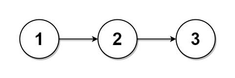
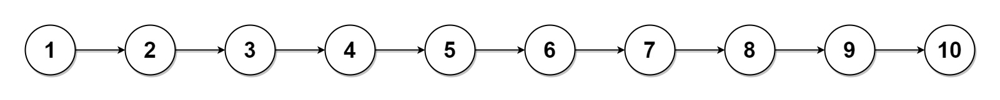

# 725. 分隔链表

给你单链表的头节点 `head` 和整数 `k`，把链表分成 `k` 个连续的部分，以数组返回。

各部分的长度应尽可能相等：任意两部分的长度相差不超过 1，因此有些部分可能为空。各部分按它们在原链表中出现的顺序排列，排在前面的部分长度不小于排在后面的部分。

**示例 1：**



```
输入：head = [1,2,3], k = 5
输出：[[1],[2],[3],[],[]]
解释：最后两部分是空链表，写作 []。
```

**示例 2：**



```
输入：head = [1,2,3,4,5,6,7,8,9,10], k = 3
输出：[[1,2,3,4],[5,6,7],[8,9,10]]
解释：10 个节点分成 3 部分，长度为 4、3、3。
```

**提示：**

- 链表中节点数目在 `[0, 1000]` 范围内
- `0 <= Node.val <= 1000`
- `1 <= k <= 50`
