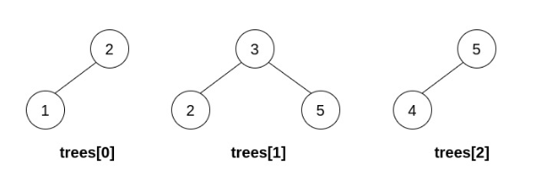
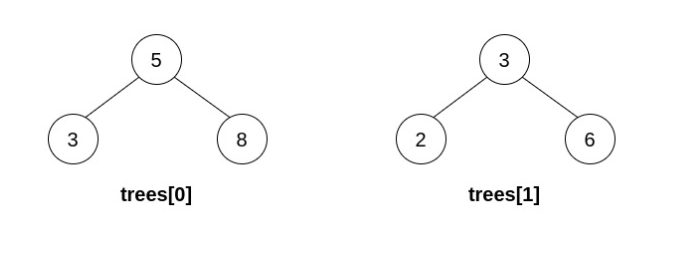
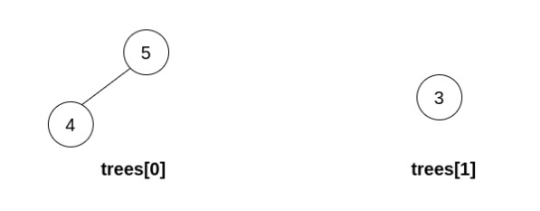

# 1932. 合并多棵二叉搜索树

给你一个数组 `trees`，其中存放着 `n` 棵二叉搜索树（BST）的根节点。每棵树**最多有 3 个节点**，且任意两棵树的根节点值互不相同。一次操作中，你可以：

- 选择两个**不同**的下标 `i` 和 `j`，要求 `trees[i]` 的某个**叶子节点**的值等于 `trees[j]` 的**根节点**的值；
- 用 `trees[j]` 替换 `trees[i]` 中的这个叶子节点；
- 从 `trees` 中移除 `trees[j]`。

如果执行 `n - 1` 次操作后能得到一棵合法的 BST，返回它的根节点；否则返回 `null`。

合法的 BST 中，每个节点左子树中的值都**严格小于**该节点的值，右子树中的值都**严格大于**该节点的值。叶子节点是没有子节点的节点。

**hc 说明：** 返回 `null` 时，输出写作空树 `[]`。

**示例 1：**



```
输入：trees = [[2,1],[3,2,5],[5,4]]
输出：[3,2,5,1,null,4]
解释：先把 trees[0] 接到 trees[1] 值为 2 的叶子上，得到 [3,2,5,1]；
再把 [5,4] 接到值为 5 的叶子上，得到 [3,2,5,1,null,4]，它是合法的 BST。
```

**示例 2：**



```
输入：trees = [[5,3,8],[3,2,6]]
输出：[]
解释：唯一可行的操作得到 [5,3,8,2,6]，6 在 5 的左子树中，不是合法的 BST。
```

**示例 3：**



```
输入：trees = [[5,4],[3]]
输出：[]
解释：无法执行任何操作。
```

**提示：**

- `n == trees.length`
- `1 <= n <= 5 * 10^4`
- 每棵树的节点数在 `[1, 3]` 范围内
- 输入中的节点可以有子节点，但没有孙节点
- 任意两棵树的根节点值都不相同
- 输入中的每棵树都是合法的 BST
- `1 <= TreeNode.val <= 5 * 10^4`
